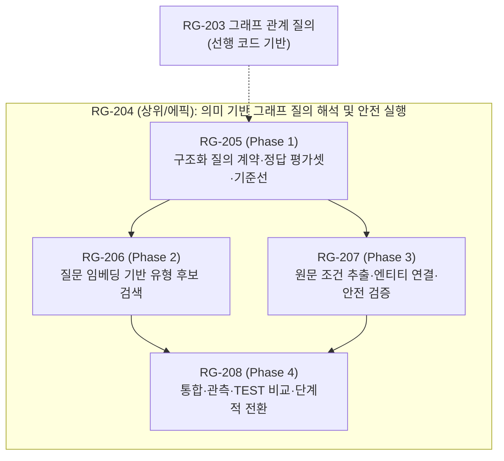

# [RG-204~208] 의미 기반 그래프 질의 해석 및 안전한 실행 전환 백로그 기획·등록 — 2026-10-22

> **문서 상태: 기획 및 백로그 등록 완료 (착수 대기 / 구현 미실행, 운영은 향후 별도 승인)**  
> RG-203 그래프 관계 질의 구현 과정에서 발생한 정규식 기반 단건 어휘/어미 보완의 반복을 근본적으로 개선하기 위해, 질문의 의미 구조(semantic structure)를 체계적으로 해석하여 7개 고정 그래프 질의 유형과 조건을 안전하게 실행하는 구조적 전환 과제(RG-204~208)를 기획하고 백로그로 등록했다. 본 문서는 기획 및 인터페이스·검증 계약 등록 기록이며, 신규 백로그 등록만으로 실제 구현, DB 쓰기, 운영 배포, Git commit/push는 일체 수행하지 않는다.

---

## 1. 기획 배경 및 문제 분석

### 발생 현상 및 단건 패치의 한계
* RG-203에서 7대 그래프 질의 기능을 제공했으나, 결정론적 정규식 파서(`src/robingraph/retrieval/graph_questions.py`)의 한계로 인해 `"새중에서"`는 `specific_fruit`/`insufficient_data`(자료 부족)로 오분류되고, `"나무열매"` 및 `"어떤게 있어"`는 `clarify`(질문 종류 판단 불가)로 오분류되는 등 일상적인 자연어 변형 유입 시 오분류 현상이 반복되었다.
* 단건 정규식 땜질을 반복하는 방식은 유한 문법 내에서 새로운 표현 누락 공백을 계속 발생시키며, 유지보수 비용과 회귀 위험을 가중시킨다.

### 해결 방향: 의미 기반 구조 해석 및 안전한 실행 체계로의 전환
* 임베딩 기반 질의 유형 탐색과 원문 조건 추출을 결합하여, 다양한 자연어 표현을 사전에 정의된 안전한 7개 질의 유형 스키마로 정규화한다.
* 원문 조건 추출 수단은 규칙·소형 모델·병행 방식 중 향후 계약 평가에 따라 결정하되, 모델이 임의로 생성한 자유 Cypher의 직접 실행은 일체 금지하고 사전 정의된 고정 Cypher 템플릿과 실제 DB 조회 결과만을 연계하는 검증 체계를 통해 오실행을 줄인다.

---

## 2. 핵심 아키텍처 원칙 및 안전 경계

1. **질문 임베딩의 역할 제한**:
   * 질문 임베딩은 **7대 질의 유형 후보 검색(`top-k`)에만 한정**하여 사용한다.
   * **과거 답변 재사용 금지**: 유사 질문이라도 캐시된 과거 답변을 직접 반환하지 않으며, 반드시 실제 DB를 조회해 최신 데이터를 근거로 답변한다.
2. **원문 조건 보존 및 안전 검증**:
   * 원문에서 종 ID 후보, 분류목, 먹이 범주, 서식지, 같음/다름, 부정, 지역 범위, 특정 식물 조건을 손실 없이 추출하여 정형 스키마로 검증한다.
   * 검증 완료된 파라미터만 기존의 고정 Cypher 쿼리에 주입하여 실행한다.
   * **자유 Cypher 생성/실행 일체 금지**: 모델이 임의로 생성한 Cypher 쿼리는 절대 실행하지 않으며, 허용된 템플릿만 실행한다.
3. **노드 및 엔티티 무단 오염 방지 및 인프라 재사용**:
   * 유입된 질문 전체를 종 엔티티, 영구 별칭(alias), 또는 그래프 내 `Query` 노드로 자동 저장하지 않는다.
   * 작업 범위 및 질의 유형 후보 자료는 별도로 관리하되, 기존 이름 해소(855개 이름 벡터) 및 검색 인프라는 재사용한다.
4. **저장소 및 인프라 공존 계약**:
   * 임베딩 저장 위치(메모리 캐시, 파일, DB 등)는 설계 및 성능/비용 측정 후 결정하며, **Neo4j 벡터 인덱스 신설을 필수로 확정하지 않는다**.
   * 기존 자체 호스팅 Jina 호환 모델 및 Jev 설정/서버를 재사용하며, **새로운 외부 상용 모델 도입이나 추가 인프라 확장을 확정하지 않는다**.
   * 에이전트 모델은 각 워크트리의 현재 설정을 그대로 사용하며, 착수 시 실제 모델명을 확인하여 기록한다 (현재 모델명 임의 추정 금지).
5. **명확한 제외 범위 (Out of Scope)**:
   * 후속 대화 문맥 유지(multi-turn conversation state)
   * 자연어 질의 답변 캐싱
   * 특정 식물(감나무 등) 상세 생태 데이터 신규 수집

---

## 3. 세부 백로그 구조 및 단계별 계획 (RG-204 ~ RG-208)

모든 신규 백로그 항목은 **P1 (높음)** 우선순위 및 **착수 대기 (구현 미실행, 운영은 향후 별도 승인)** 상태로 등록된다. 상위 과제인 **RG-204는 하위 과제의 완료 선행 조건이 아니라 이들을 묶는 상위 에픽(Parent Epic)**이며, 실제 구현·평가 순서는 **RG-205(선행 계약) → RG-206/207(유형 탐색/조건 추출) → RG-208(통합 및 단계적 전환)** 순으로 진행된다.

### [RG-204] 의미 기반 그래프 질의 해석 및 안전한 실행 전환 (상위/에픽)
* **주관 / 권장 담당**: Codex (작업 조율·통합 검증), Claude (검색 로직·의미 추출), Antigravity (필요 시 UI), Writer (문서·백로그)
* **목적**: 4개 하위 과제(RG-205~208)의 진행 및 완료를 총괄하며 정규식 한계를 극복하는 아키텍처 전환 관리
* **완료 게이트 (Acceptance Criteria)**:
  1. 하위 4개 과제(205, 206, 207, 208) 평가 및 검증 완료
  2. 실제 TEST 환경 배포 및 엔드투엔드 루프백/브라우저 검증 통과
  3. 오류/모호/미지원 질의의 안전한 보류(`clarify`/`insufficient_data`) 검증
  4. 필수 회귀 검사 통과 및 skip 사유(미검증 환경 구분) 명시 (현재 opt-in 39건을 억지로 전부 실행하는 계획이 아님)
  5. 운영 배포는 사용자 명시 승인 후 진행

### [RG-205] 구조화 질의 계약·정답 평가셋·현재 기준선 (Phase 1)
* **주관 / 권장 담당**: Claude (평가셋 구축), Codex (독립 평가·계약 검증)
* **목적**: 7대 그래프 질의 유형 및 조건 파라미터를 표현하는 표준 DTO 스키마 정의, 고품질 사람 검토 Gold 평가셋 구축 및 현재 기준선(baseline) 측정
* **주요 내용**:
  - 허용 질의 유형(7개) 고정: `common_taxonomy`, `same_genus`, `korea_same_genus`, `order_fruit`, `specific_fruit`, `habitat_shared_diet`, `habitat_different_diet`.
  - 정답 평가셋 구축: 실제 사용자 실패 3문장(`"새중에서"`의 `specific_fruit` 오분류, `"나무열매"` 및 `"어떤게 있어"`의 `clarify` 오분류) + 자연어 변형, 띄어쓰기, 오타, 어순 변형, 동일 범주 대조군 및 원문에 명시되지 않은 조건을 추론해 추가하지 않는지 확인하는 대조 질문 포함.
  - Gold 데이터 경계 확립: 일반 열매 vs 감나무(특정식물 `insufficient_data`), 나무·풀 열매 미구분 한계 고지, 서식지 범주 일치 vs 실제 동소성(공존) 명확히 구분.
  - 기계 생성 회귀(664건)를 독립 자연어 품질 증거로 간주하지 않고, 사람 검토 gold / 프롬프트 및 임계치 조정용(tuning) / 고정 평가용(holdout)으로 엄격히 분리.
  - 평가 지표: 유형 정확도, 조건 정확도, 잘못된 실행률(false execution), 적정 보류율, p50/p95 지연시간. 목표 수치 및 지연/비용 상한은 기준선 측정 후 구현 착수 전에 고정(미정 상태로 출발).

### [RG-206] 질문 임베딩 기반 질의 유형 후보 검색 (Phase 2)
* **주관 / 권장 담당**: Claude (검색 모델 로직), Codex (성능·설정 검증)
* **선행 과제**: RG-205 (계약 및 gold 평가셋)
* **목적**: 임베딩 유사도를 활용하여 사용자 자연어 질의로부터 7대 질의 유형 중 적합한 후보를 안전하게 탐색
* **주요 내용**:
  - 버전 관리되는 대표 질문(canonical prototypes) 및 패러프레이즈 임베딩 구축.
  - 유형별 top-k 후보, 유사도 점수, 차순위와의 격차(margin) 기반 신뢰도 산출 및 기준 미달 시 안전 보류.
  - 공존 설계: 기존 `SemanticRouter`(taxonomy/observations/evidence 3개 prototype 분류), 그래프 7개 정규식, Jev 라우터와 중복 라우터를 신설하지 않고 조화로운 우선순위 확립.
  - 유형 후보만으로 종/조건을 임의 확정하거나 과거 답변을 재사용하는 행위 절대 금지.
  - 임계치 튜닝셋과 holdout 평가셋 분리 검증, 자체 호스팅 임베딩 API의 실제 지연시간 측정.

### [RG-207] 원문 조건 추출·엔티티 연결·안전 검증 (Phase 3)
* **주관 / 권장 담당**: Claude (추출·엔티티 연결), Codex (API 계약 및 안전 리뷰)
* **선행 과제**: RG-205 (RG-206과 병렬 진행 가능)
* **목적**: 질문 원문에서 질의 파라미터를 손실 없이 추출하여 RG-205 스키마로 구조화하고, 유효성 및 경계를 엄격히 검증
* **주요 내용**:
  - 추출 수단(규칙/소형 모델/병행)은 계약 평가 후 결정하며 모델 출력도 엄격한 검증 대상.
  - 종명 추출 시 기존 이름 해소(`taxon_name_resolution.py`)를 통해 실제 유효한 Taxon ID로 재검증, 모호한 경우 사용자 확인(`clarify`) 유도.
  - 안전 검증 원칙: 누락/충돌/미지원 조건 및 근거 부재 시 `clarify` 또는 `insufficient_data` 반환.
  - 감나무 질의를 일반 열매로 몰래 완화 금지(`insufficient_data` 유지), 나무열매 일반 범주 참고 시 나무·풀 구분 없음 한계 명시, 근거 없는 임의 관계 생성 금지.
  - 자유 Cypher 생성/실행 일체 금지, 검증된 파라미터화 템플릿만 실행하여 오실행을 줄임. API payload 변경 시 Codex 및 Antigravity와 조율.

### [RG-208] 통합·관측·TEST 비교·단계적 전환 (Phase 4)
* **주관 / 권장 담당**: Codex (통합·TEST 배포), Claude (검색 로직), Antigravity (필요 시 UI), Writer (기록)
* **선행 과제**: RG-205, RG-206, RG-207
* **목적**: Feature flag 및 shadow 실행을 통해 기존 정규식 파서와 병행 평가하고 안전하게 단계적 전환 수행
* **주요 내용**:
  - 기능 플래그(feature flag) 기반 섀도우 비교: 기존 정규식 경로를 유지하며 동일 gold 평가셋에 대한 응답 비교.
  - 회귀 검증: 명시적 intent/filter, 사용자 지정 `species_scope` (`all`, `korea`, `outside`, `unknown` 4개 범위 모두), 단일 종 사실 조회, 장애 fallback, 자료 부족 처리.
  - MLflow 관측성 연동: 라우팅 결과, 신뢰도, 보류 사유, 응답 지연, 모델 버전 기록 (인증 정보 및 불필요한 개인정보/원문 저장 금지).
  - 실제 TEST DB/API 및 공개 PC/모바일 브라우저 실측 검증.
  - 캐시 전후 임베딩 호출 수, p50/p95 지연, 시스템 자원, 에러율 정량 비교.
  - 롤백 방안: 장애 발생 시 즉시 기존 정규식 경로로 복원 가능 (공유 TEST 벡터 색인은 삭제/교체하지 않음).
  - 운영 배포는 TEST 결과 확인 후 명시적 사용자 승인 필수. 구현 전 결정해야 할 새 필드명 및 실측 목표 수치는 '미정'으로 명시.

---

## 4. 관련 소스 파일 및 예정 경로

### 현재 주요 소스 파일 경로 (실존 확인)
* `src/robingraph/api/semantic_router.py` (기존 의미 라우터)
* `src/robingraph/api/jev_router.py` (Jev 분류 라우터)
* `src/robingraph/api/services.py` (서비스 통합 계층)
* `src/robingraph/api/schemas.py` (입출력 DTO 계약)
* `src/robingraph/api/drf/application.py` (DRF 엔드포인트)
* `src/robingraph/retrieval/graph_questions.py` (그래프 질의 해석기 및 7대 쿼리 핸들러)
* `src/robingraph/retrieval/taxon_name_resolution.py` (분류군 이름 해소기)
* `src/robingraph/embeddings/__init__.py` (자체 호스팅 임베딩 인터페이스)
* `tests/test_graph_questions.py` (그래프 질문 단위/조합 테스트)
* `tests/test_graph_questions_api.py` (API 계약 및 Mock 테스트)
* `tests/test_semantic_chat.py` (시맨틱 챗 테스트)

### 신규 모듈 및 평가 자료 경로 (예정)
* `src/robingraph/retrieval/graph_intent_schema.py` (구조화 질의 계약 스키마, 예정)
* `src/robingraph/retrieval/graph_semantic_router.py` (질문 임베딩 기반 유형 후보 라우터, 예정)
* `src/robingraph/retrieval/graph_condition_extractor.py` (원문 조건 추출 및 안전 검증기, 예정)
* `data/eval/graph_questions/` (사람 검토 Gold 세트 및 Holdout 평가 자료 디렉터리, 예정)

---

## 5. 작업 안전성 및 형상 관리 준수

* **DB 쓰기 검증 격리**: 등록 과정에서 DB 쓰기 0건, 인덱스 생성 0건.
* **운영 배포 경계**: Production 배포, 컨테이너 재시작, 운영 환경 변경 없음.
* **Git 형상 관리**: 별도 지시 없이 commit, push, branch 변경을 수행하지 않음.
* **상태 보존**: 기존 RG-203(`진행 중 (TEST 검증 완료, 운영 배포 승인 대기)`), RG-101(`보류`) 등 모든 기존 항목 상태 및 우선순위 보존.

---

## 관련 문서 및 백로그 링크

- [[Work/RobinGraph/RobinGraph 작업 백로그|RobinGraph 전체 작업 백로그]]
- [[Work/RobinGraph/작업기록/2xx 검색·RAG·그래프 질의/작업 백로그|2xx 검색·RAG·그래프 질의 작업 백로그]]
- 선행 작업 상세:
  - [[Work/RobinGraph/백로그 상세/RG-203|RG-203 — 그래프 관계 기반 질의응답 (상세 백로그)]]
- 신규 상세 백로그 (착수 대기):
  - [[Work/RobinGraph/백로그 상세/RG-204|RG-204 — 의미 기반 그래프 질의 해석 및 안전한 실행 전환 (상위/에픽)]]
  - [[Work/RobinGraph/백로그 상세/RG-205|RG-205 — 구조화 질의 계약·정답 평가셋·현재 기준선]]
  - [[Work/RobinGraph/백로그 상세/RG-206|RG-206 — 질문 임베딩 기반 질의 유형 후보 검색]]
  - [[Work/RobinGraph/백로그 상세/RG-207|RG-207 — 원문 조건 추출·엔티티 연결·안전 검증]]
  - [[Work/RobinGraph/백로그 상세/RG-208|RG-208 — 통합·관측·TEST 비교·단계적 전환]]
